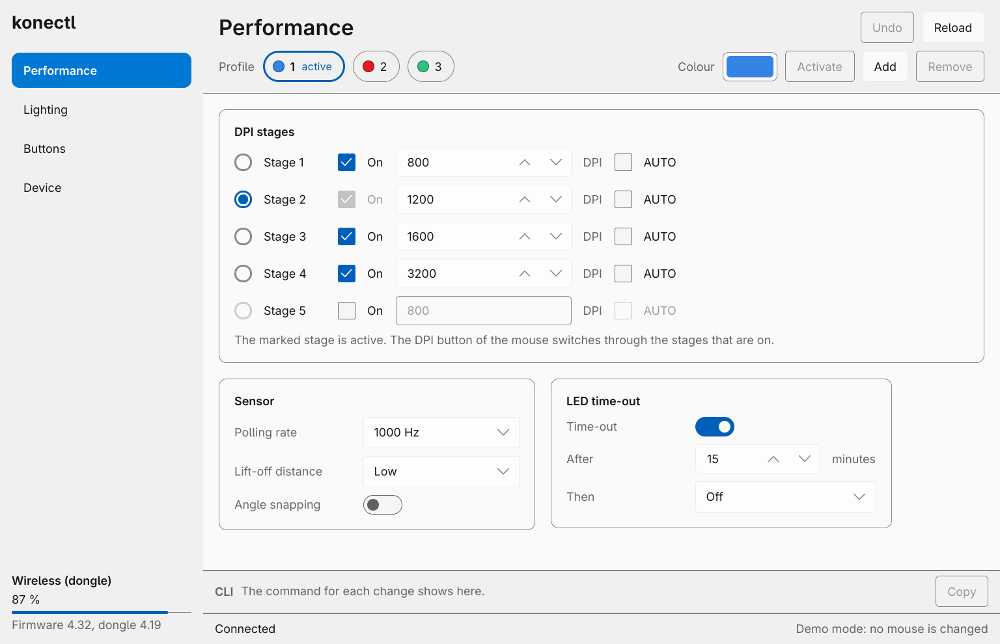

# konectl

Unofficial Linux tool, desktop app and Rust library to configure the **ROCCAT Kone Pro
Air** mouse.
Not affiliated with ROCCAT or Turtle Beach.

ROCCAT's configuration software (Swarm) only runs on Windows, and existing Linux
tools (libratbag/Piper, roccat-tools) don't support this mouse. konectl talks
to the mouse directly over hidraw.

## Status

| Feature                                   | State |
|-------------------------------------------|-------|
| Battery level and charging, wireless signal | ✅   |
| DPI stages and active stage               | ✅     |
| Polling rate, lift-off distance           | ✅     |
| Angle snapping, debounce time             | ✅     |
| LED time-out, energy saving               | ✅     |
| DPI "AUTO" flags, lift-off calibration, colour intensity | ✅ |
| Saved lighting (effect, colours, brightness, speed) | ✅ |
| Profiles (show, activate, add, remove, colour, per-profile settings) | ✅ |
| Factory reset, pairing with the dongle    | ✅     |
| Button assignment (standard and Easy-Shift layer) | ✅ |
| Macros (keys with delays, played by the mouse itself) | ✅ |
| Backup and restore of the per-profile settings and buttons (not energy saving, the lift-off calibration or the keys of macros) | ✅ |
| Live LED colours (lost on sleep)          | ✅     |

Tested with mouse firmware 4.32 (dongle firmware 4.19), over the wireless dongle
and the USB cable. See
[docs/protocol.md](docs/protocol.md) for the protocol and
[docs/reverse-engineering.md](docs/reverse-engineering.md) for how it was worked out.

## Desktop app



`konectl-gui` does what the command-line tool does, in a window: DPI stages and
sensor settings, lighting with a live preview, button functions and macros on a
drawing of the mouse, profiles, pairing, backups and the factory reset. Changes
are written to the mouse right away and can be undone, and the app shows the
matching `konectl` command for each one. If the mouse cannot be opened, it offers
to install the udev rule (see [Permissions](#permissions)).

More pages: [Lighting](docs/screenshots/lighting.png),
[Buttons](docs/screenshots/buttons.png), [Device](docs/screenshots/device.png).

## Layout

- `crates/konectl`: the library (`Manager`, `KoneProAir`, `settings`, `protocol`)
- `crates/konectl-cli`: the `konectl` command-line tool
- `crates/konectl-gui`: the `konectl-gui` desktop app (Slint)
- `tools/re`: Windows VM and USB capture scripts used to decode the protocol

## Install

### Command-line tool

Building needs Rust 1.88 or newer, a C compiler, `pkg-config` and the libudev
development files: `gcc`, `pkgconf` and `systemd-libs` on Arch;
`build-essential`, `pkg-config` and `libudev-dev` on Debian and Ubuntu; `gcc`,
`pkgconf` and `systemd-devel` on Fedora.

```sh
cargo install konectl-cli                 # installs the konectl binary into ~/.cargo/bin
cargo install --path crates/konectl-cli   # or from a clone of this repository
```

To use the library in your own project: `cargo add konectl`
([API documentation](https://docs.rs/konectl)).

### Desktop app

Each [release](https://github.com/Bl4ckspell7/konectl/releases) has:

- `konectl-VERSION-x86_64-linux.tar.gz`: both programs, the desktop file and the
  icon, for distributions with glibc 2.36 or newer. Unpack it into `~/.local`:

  ```sh
  tar -xzf konectl-VERSION-x86_64-linux.tar.gz
  cp -r konectl-VERSION-x86_64-linux/bin konectl-VERSION-x86_64-linux/share ~/.local/
  ```

- `konectl-VERSION.flatpak`: the desktop app as a Flatpak bundle (its runtime
  comes from Flathub):

  ```sh
  flatpak install --user konectl-VERSION.flatpak
  ```

  A Flatpak cannot install the udev rule: the app shows the commands to run
  instead. It keeps its safety backups in its own directory
  (`~/.var/app/io.github.bl4ckspell7.konectl`), apart from the CLI's.

From crates.io, with Rust 1.95 or newer: besides the build dependencies of the
CLI, the GUI needs the fontconfig development files (`fontconfig` on Arch,
`libfontconfig-dev` on Debian and Ubuntu, `fontconfig-devel` on Fedora).

```sh
cargo install konectl-gui
```

## Permissions

By default, only root can open the mouse's `/dev/hidraw*` nodes. konectl ships
a udev rule that gives the logged-in user access to the configuration interface
only (not to the mouse input itself):

```sh
konectl udev install     # installs and applies the rule (asks for your password via sudo)
konectl udev status      # is the rule installed, can the mouse be opened?
konectl udev uninstall   # removes it again
```

`konectl udev install` shows each command before it runs it. To install the
rule yourself, e.g. in a distribution package, `konectl udev rule` prints it;
it is also in the repository as `udev/70-konectl.rules`.

## Usage

```sh
konectl list                    # connected devices
konectl battery                 # e.g. 87%, or 90% (charging) on the cable
konectl signal                  # e.g. 92% (raw 36)

konectl settings                # settings of the active profile
konectl settings -p 2           # … of profile 2
konectl dpi 2 900               # DPI stage 2 → 900 DPI
konectl dpi 3 off               # disable stage 3
konectl stage 2                 # make stage 2 the active stage
konectl rate 1000               # polling rate: 125, 250, 500 or 1000 Hz
konectl liftoff low             # lift-off distance: very-low or low
konectl angle-snapping off      # angle snapping: on or off
konectl debounce 2              # debounce time in ms (0–10), set in all profiles
konectl liftoff calibrate       # measure your surface, then use "custom" in all profiles
konectl dpi-auto 2 on           # the "AUTO" flag of DPI stage 2
konectl led-timeout 5 -e breathing   # after 5 idle minutes: breathing (or off, static, …)
konectl led-timeout never       # the LEDs never time out
konectl energy-saving on        # energy saving: on or off (all profiles)
konectl lighting static --left ff0000 --right 0000ff -b 60
konectl lighting static --intensity 50   # colour intensity (also --left-/--right-intensity)
konectl lighting wave -s 4      # effects: off, static, breathing, heartbeat,
                                #          wave, blinking, aimo, battery
konectl profile                 # profiles in use; konectl profile 2 activates one
konectl profile add             # add a profile, a copy of the active one (--copy-from N)
konectl profile remove 4        # remove profile 4; the profiles after it move down
konectl profile color 2 f40000  # the colour the DPI LED flashes for profile 2 (or none)

konectl buttons                 # button assignments (standard and Easy-Shift layer)
konectl button 7 back           # rear side button: browser back
konectl button 7 key:ctrl+c     # a key with modifiers
konectl button 3 mute -e        # Easy-Shift layer: while the Easy-Shift button is held
konectl button 7 easy-aim:400   # 400 DPI while the button is held
konectl button 7 'macro:ctrl+c, 50ms, ctrl+v'   # a macro the mouse plays itself
konectl button 7 'macro:space' --repeat 3       # … or --while-pressed / --toggle
                                # all functions: konectl button --help

konectl backup my-mouse.txt     # save all profiles
konectl restore my-mouse.txt    # write them back (profiles not in the file are removed)

konectl reset                   # factory settings (asks first; undo with restore)
konectl pair                    # pair the mouse with the dongle (asks first, guides you)

konectl led ff0000 0000ff       # live colours until the mouse sleeps (not saved)
konectl raw 90 0a               # send a raw report, print the replies (debugging)
```

The settings commands change the active profile unless `-p` is given. They are
saved on the mouse and checked by reading them back. The mouse must be awake:
move it if konectl reports that it does not answer.

Before each change konectl saves the current settings of all profiles to
`${XDG_STATE_HOME:-~/.local/state}/konectl/previous.txt`; the state before the
first change ever is kept in `original.txt`. Undo a change with
`konectl restore ~/.local/state/konectl/previous.txt`.

`raw` is a tool for protocol work. Unknown commands can change or break the mouse
configuration, so only send what the official software was seen sending.

## Library

```rust
use konectl::{Manager, Rgb};

let manager = Manager::new()?;
let mut mouse = manager.open_first()?;
println!("battery: {:?}%", mouse.battery()?.percent());

let mut settings = mouse.settings(None)?; // active profile
settings.sensor.set_dpi(2, Some(900))?;
settings.lighting.set_left(Rgb::new(255, 0, 0));
mouse.write_settings(&settings)?;
```

## License

GPL-3.0-or-later. See [LICENSE](LICENSE).
